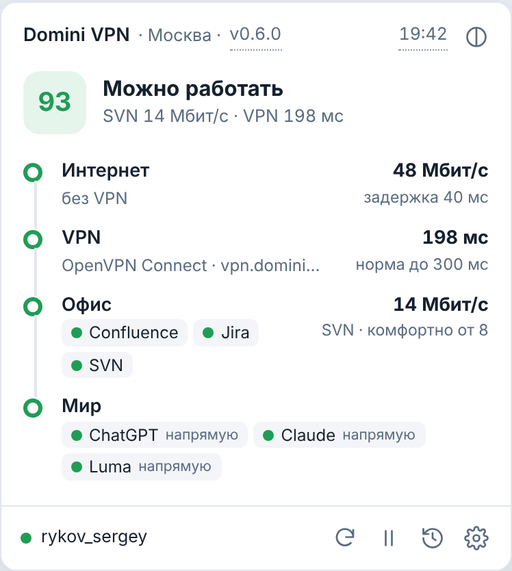
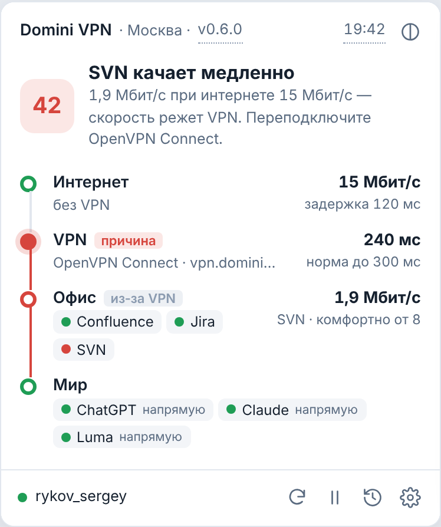
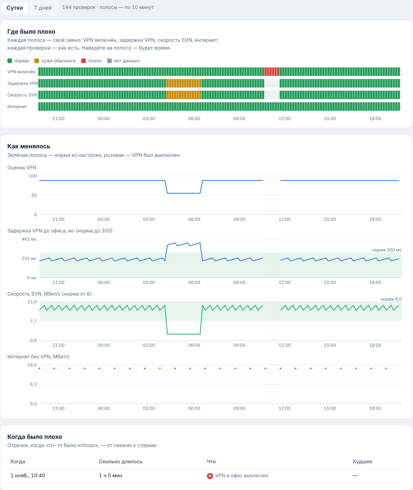

# Domini VPN Monitor

Иконка в трее Windows отвечает на два вопроса: **можно ли сейчас работать** и, если нет, **кто виноват** — ваш
интернет, VPN или сервис офиса. Приложение само проверяет Confluence, Jira, SVN, интернет и сервисы в мире
(ChatGPT, Claude, Luma) и называет виновника словами.

  
  &nbsp;
  

Слева — всё в порядке. Справа — SVN качает 1,9 Мбит/с при интернете 15 Мбит/с: виноват VPN, и меню советует
переподключить OpenVPN. Все экраны во всех состояниях — [галерея экранов](docs/screens.html) (скачайте файл и
откройте в браузере).

## Поставить
1. Скачайте `domini-vpn-monitor.exe` со страницы [релизов](https://github.com/dominigamesru/vpn-monitor/releases)
   (верхний релиз без пометки Pre-release).
2. Запустите двойным кликом. Права администратора не нужны: приложение встанет в `%LOCALAPPDATA%\DominiVPNMonitor`,
   включит автозапуск, положит ярлык «Domini VPN Monitor» на рабочий стол и откроет окно.
3. Войдите логином и паролем AD на вкладке «Подключение». Пароль хранится в Диспетчере учётных данных Windows.

Обновления приходят сами. Если иконка спряталась под «^», перетащите её на панель задач — Windows запомнит.

## Как читать
- **Иконка в трее:** число 1–99 — оценка VPN; зелёный — можно работать, жёлтый — медленно, красный — тяжело;
  «!» — VPN выключен; серый «×» — нет интернета. Синяя точка в углу — идёт проверка. Наведите — будет вывод и цифры.
- **Левый клик** — меню: вывод, маршрут «Интернет → VPN → Офис → Мир», звено-виновник отмечено. Внизу — проверить
  сейчас, пауза, история, настройки; слева — ваша учётная запись с точкой: зелёная — все сервисы приняли вход.
- **Окно** (ярлык на рабочем столе или «История» в меню): сейчас, история за сутки и неделю, подключение.

| Что видите | Что делать |
|---|---|
| «VPN выключен» | Включите VPN-клиент (OpenVPN Connect, Happ) |
| «SVN качает медленно — скорость режет VPN» | Переподключите VPN; не помогло — напишите в поддержку (ниже) |
| «Медленный интернет» | VPN не виноват: смените сеть или подождите |
| «Пароль AD не подошёл» | Вкладка «Подключение» → войти заново |
| «Wi‑Fi требует входа» | Откройте браузер и войдите на странице сети (отель, кафе) |

## Если что-то не работает
1. В окне на вкладке «Подключение» нажмите **«Скопировать сводку для поддержки»** и вставьте в чат поддержки.
2. Там же — **«Проверить подключение»**: шаги проверки каждого сервиса (DNS, соединение, вход).
3. Нужны подробности — приложите `vpn-monitor.log` из `%LOCALAPPDATA%\DominiVPNMonitor` (в логе нет паролей и токенов).
4. Меню не открывается или выглядит странно — перезапустите приложение: «Выйти» в меню, затем ярлык на рабочем столе.

## Для разработки
Устройство, сборка, релизы и правила — [DEVELOPMENT.md](DEVELOPMENT.md).
